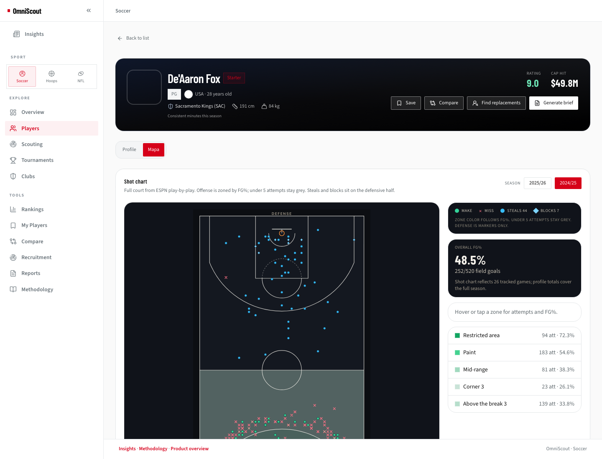
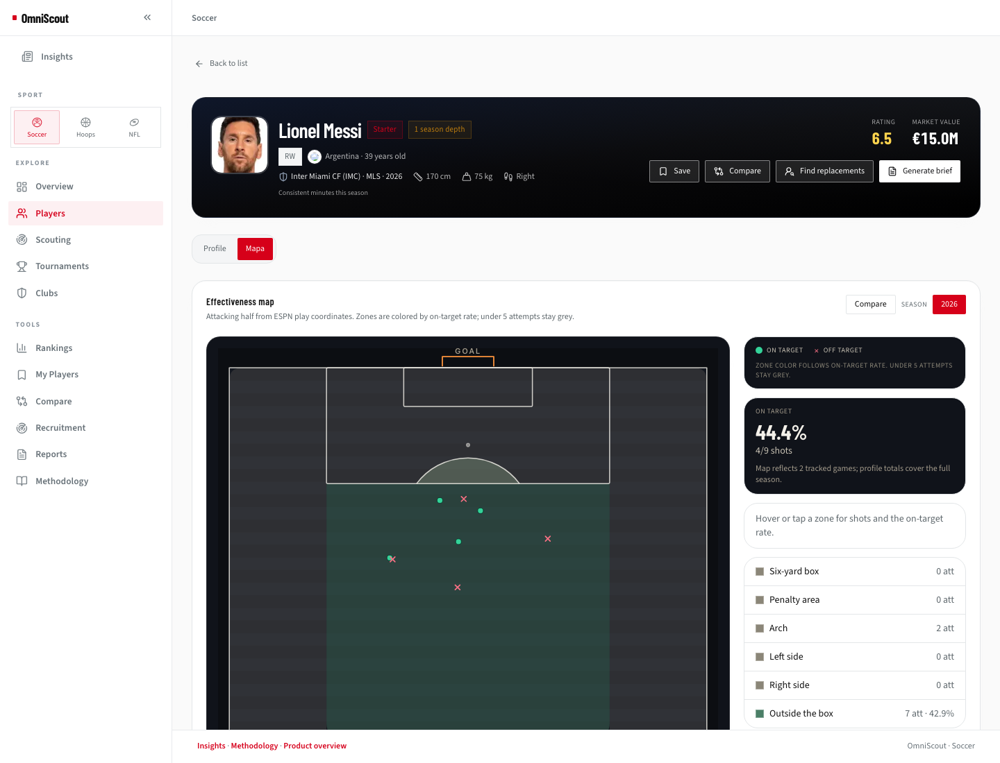
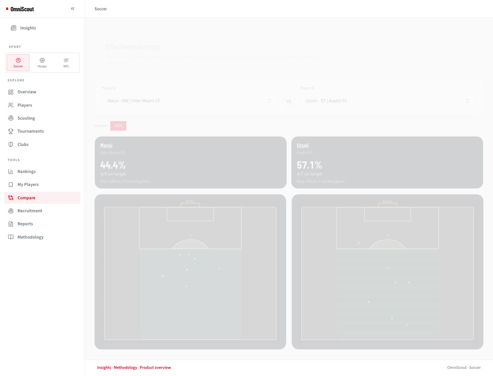

# OmniScout

<p align="center">
  
</p>

Public sports data is scattered and raw. Scouts and analysts need structured views they can trust.

OmniScout is a multi sport scouting desk for soccer, basketball, American football, and hockey. It turns public game data into roles, fit, comparisons, shot maps, and briefs. It does not invent stats: a soccer season counts only with at least four appearances and 270 minutes, shot zones stay grey under five attempts, and a value with no trustworthy source stays Undisclosed.

Stack: Next.js 16, TypeScript, Tailwind, Prisma and Postgres. Ingestion sits behind a provider interface. ESPN is the live adapter. The official NHL API feeds hockey.

This is a live production side project, actively developed. Auth and a paid pilot are not built yet.

**Live:** [omni-scout.vercel.app](https://omni-scout.vercel.app)

---

## Status — October 2026

| Area | Now |
|------|-----|
| Production | [omni-scout.vercel.app](https://omni-scout.vercel.app) on Vercel (`main`) |
| Soccer | Roles, recruitment fit, comparisons, effectiveness maps, and scout briefs. Productive seasons need at least four appearances and 270 minutes |
| Basketball | Court maps split into offense, defense, and full views. Rates stay hidden under five attempts |
| American football | NFL and college football hubs. The Results tab keeps earlier finals when the current week is still unplayed |
| Hockey | NHL desk from the official API: 32 clubs, headshots, standings, and shot maps folded onto one attacking net. Market value stays Undisclosed |
| Tournaments | A sport with one competition opens that hub directly. A sport with more than one keeps the index |
| Soccer maps | Player map, team map, and a [side by side comparator](https://omni-scout.vercel.app/compare/maps) for one shared season |
| Insights | [Insights](https://omni-scout.vercel.app/insights): one question, the data, one chart. The archive is in the app; email stays on Substack |
| Auth / paid pilot | Not yet |

<p align="center">
  
</p>

<p align="center"><em>Basketball shot chart. De'Aaron Fox, 2024/25. 252/520 field goals across 26 tracked games.</em></p>

<p align="center">
  
</p>

<p align="center"><em>Soccer effectiveness map. Lionel Messi, MLS 2026. 4/9 on target. Zones under five attempts stay grey.</em></p>

<p align="center">
  
</p>

<p align="center"><em>Map comparator. Messi and Uzuni, 2026, same zones and the same grey under five rule.</em></p>

There is no hockey screenshot in `docs/assets` yet.

---

## Technical Decisions

- **Provider interface.** ESPN is the live adapter. A paid source can be added later as another adapter, without rewriting the desk.
- **Honest empty states.** Missing numbers stay missing. Shot zones under five attempts stay grey. Hockey market value stays Undisclosed because the feeds in use have no trustworthy cap hit.
- **Per sport labels.** Hockey, basketball, and American football do not reuse soccer words for positions, seasons, or team records.
- **Test first fixes.** A behavior change lands with a regression test that fails before the fix.
- **Hockey shot coordinates.** The NHL feed is not attacking normalized. The map folds each shot onto one net at render time and does not invent a location.
- **Transfermarkt is soccer only.** Enrichment refuses hockey, basketball, and American football, so a name match cannot overwrite another sport.

---

## Stack

- Next.js 16 (App Router), TypeScript, Tailwind
- Prisma and Postgres
- Ingestion through a provider interface. ESPN is the live adapter. API Football enriches soccer within a free daily quota. College Football Data is optional for college football. Hockey uses the official NHL API
- Deploy: Vercel, `main` to production

---

## Quick start

```bash
cp .env.example .env   # DATABASE_URL, APISPORTS_KEY, DATA_SOURCE=db|mock
npm install
npx prisma generate
npm run dev
```

Demo data modes: [docs/DEMO-DATA-SOURCE.md](./docs/DEMO-DATA-SOURCE.md).

```bash
npm run data:coverage
npm run data:backfill-soccer-seasons -- --low-quota
```

Depth commands: [docs/STARTUP-DATA-RUNBOOK.md](./docs/STARTUP-DATA-RUNBOOK.md). Provider swap (one adapter plus env vars): [docs/data-providers.md](./docs/data-providers.md).

---

## Soccer scoring, in short

| Idea | Rule |
|------|------|
| Goals/90 | `(goals / minutes) × 90`, soft cap 1.8 |
| Rating | Goals/90 and assists/90 proxy, minutes at least 450 |
| Productive season | At least 4 appearances **and** 270 minutes |

Detail: [docs/SCORING.md](./docs/SCORING.md) and [/methodology](https://omni-scout.vercel.app/methodology) in the app.

---

## Docs

| Doc | Use |
|-----|-----|
| [OMNISCOUT-MVP.md](./docs/OMNISCOUT-MVP.md) | Startup narrative |
| [PRODUCT-UI-NORTH-STAR.md](./docs/PRODUCT-UI-NORTH-STAR.md) | Design direction |
| [STARTUP-DATA-RUNBOOK.md](./docs/STARTUP-DATA-RUNBOOK.md) | Depth pipelines |
| [DATA-COVERAGE.md](./docs/DATA-COVERAGE.md) | Coverage inventory |
| [data-providers.md](./docs/data-providers.md) | ESPN now; paid adapters later |
| [INTELLIGENCE-PARITY-V1-AUDIT.md](./docs/INTELLIGENCE-PARITY-V1-AUDIT.md) | Intelligence parity |

This is a scout decision layer on public feeds and our own pipelines, not an Opta enterprise feed.
